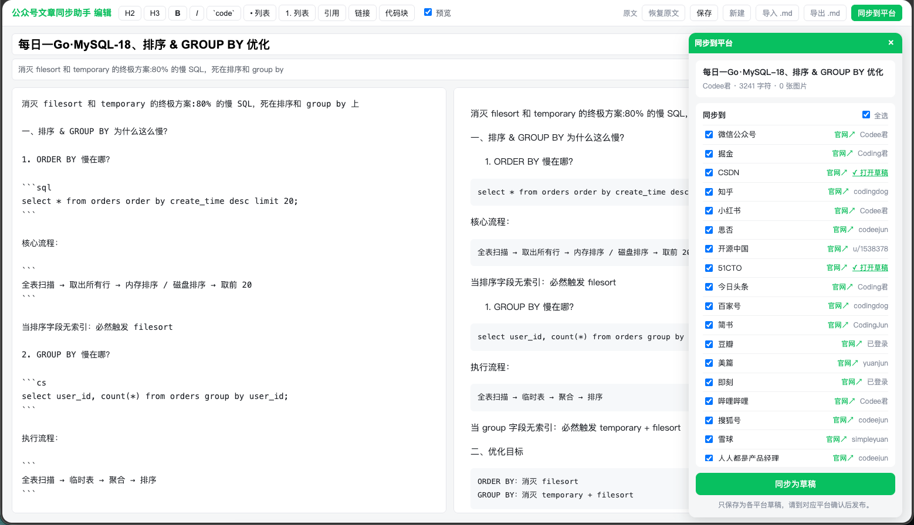

# 公众号文章同步助手

把微信公众号文章一键保存为其他内容平台的草稿，支持本地编辑、自动保存、图片转存和草稿链接回跳。

[](https://github.com/imoowi/mp-sync/actions/workflows/test.yml)
[](LICENSE)
[](https://github.com/imoowi/mp-sync/releases/latest)



这是一个开源的 Microsoft Edge / Google Chrome Manifest V3 扩展。它没有开发者服务器，文章、编辑内容和同步记录只保存在浏览器本地；只有在你主动选择平台并点击“同步为草稿”后，数据才会发送到对应平台。

> 扩展只保存草稿，不会自动发布，也不会绕过平台登录、验证码或访问限制。

## 功能

- 从微信公众号文章页读取标题、作者、摘要、正文、图片和封面。
- 使用 Markdown 编辑器修改文章，按文章地址自动保存，可随时恢复原文。
- 一次选择多个平台，将文章保存到各平台草稿箱。
- 对支持的平台直接调用草稿接口；其他平台打开编辑器并自动填充内容。
- 自动下载公众号图片并转存到目标平台图床，尽量解决图片防盗链问题。
- 记录草稿 ID 和链接，再次同步时可更新已创建的草稿。
- 每个平台使用独立适配器，平台改版时可按平台单独修复。

## 支持平台

| 同步方式 | 平台 |
| --- | --- |
| 接口直接保存草稿 | 微信公众号、掘金、CSDN、知乎、思否、开源中国、51CTO、简书、哔哩哔哩、搜狐号、雪球、人人都是产品经理 |
| 打开编辑器自动填充 | 小红书、今日头条、百家号、豆瓣、美篇、抖音图文 |
| 动态内容填充 | 即刻（标题、摘要和原文链接，需用户自行确认发送） |

各平台接口均为非公开接口，可能随平台改版失效。扩展不会点击发布按钮；抖音、美篇等平台的具体草稿流程以编辑器当前界面为准。

## 安装

### 从 Release 安装

1. 打开 [最新 Release](https://github.com/imoowi/mp-sync/releases/latest)，下载 `gzh-sync-<version>.zip`。
2. 解压 ZIP 文件。
3. Edge 打开 `edge://extensions`，Chrome 打开 `chrome://extensions`。
4. 开启“开发人员模式”，点击“加载解压缩的扩展”，选择解压后的目录。
5. 在浏览器中分别登录需要同步的平台。扩展复用已有登录状态，不保存账号密码。

### 从源码安装

在浏览器扩展管理页选择“加载解压缩的扩展”，直接选择本仓库根目录即可。项目不需要安装依赖或执行构建。

## 使用

1. 打开任意 `https://mp.weixin.qq.com/s/...` 文章。
2. 点击页面右侧的“编辑文章”，或点击扩展图标后选择“去同步”。
3. 在 Markdown 编辑页修改标题、摘要和正文。
4. 点击“同步到平台”，勾选目标平台。
5. 点击“同步为草稿”，完成后打开草稿链接检查内容并自行发布。

编辑内容按文章地址保存在本地，下次打开同一篇文章仍会保留。编辑页中的“恢复原文”可以放弃修改。

## 开发

要求 Node.js 22 或更高版本，无需安装 npm 依赖。

```bash
git clone https://github.com/imoowi/mp-sync.git
cd mp-sync
npm test
```

常用命令：

```bash
npm test          # 运行全部测试
npm run pack      # 自检并生成 dist/gzh-sync-<version>.zip
npm run icons     # 重新生成插件图标
```

发布前请确认 `manifest.json`、`package.json`、`docs/review-notes.md` 和隐私政策中的版本信息一致。

## 项目结构

```text
manifest.json          # 扩展清单与权限
background.js          # 调度各平台适配器
content/wechat.js      # 抓取公众号文章
content/panel.js       # 文章页右侧面板
adapters/*.js          # 各平台 checkLogin / publish 适配器
lib/html2md.js         # HTML -> Markdown
lib/http.js            # 请求与 Cookie 工具
lib/fill.js            # 页面编辑器自动填充
popup/                 # 编辑页和弹窗界面
icons/                 # 扩展图标
scripts/               # 图标生成与商店打包脚本
tests/                 # Node.js 测试
docs/                  # 隐私政策、权限说明和商店审核材料
```

## 隐私与安全

- 扩展没有开发者运营的数据服务器，不包含广告、统计 SDK 或远程代码。
- 文章和编辑内容保存在 `chrome.storage.local`。
- Cookie 和部分平台的网页 `localStorage` 只用于判断登录状态及完成平台请求校验，不导出到开发者。
- 完整的数据处理说明见 [隐私政策](docs/privacy.html)，权限用途见 [docs/permissions.md](docs/permissions.md)。
- 安全问题请不要公开提交 Issue，按 [SECURITY.md](SECURITY.md) 私下报告。

## 已知限制

- 平台接口并非官方公开 API，改版后可能需要更新适配器。
- 部分平台要求中国大陆网络、手机号或扫码登录。
- 页面自动填充依赖目标平台的 DOM，平台前端更新后可能失效。
- 微信图片有防盗链，个别图片或平台仍可能需要手动重新上传。
- 扩展只负责创建草稿，不代替用户检查版权、平台规则或最终发布内容。

## 参与贡献

欢迎提交 Bug、平台适配和新功能。开始前请阅读 [CONTRIBUTING.md](CONTRIBUTING.md) 和 [CODE_OF_CONDUCT.md](CODE_OF_CONDUCT.md)。

提交 Pull Request 前至少运行：

```bash
npm test
npm run pack
```

## License

本项目使用 [MIT License](LICENSE)。

本项目不是腾讯、微信、Microsoft、Google 或任何受支持平台的官方产品，也未获得其背书或授权。文中出现的平台名称和商标归各自权利人所有。

---

English: WeChat Article Draft Sync is an open-source Chromium extension that saves WeChat Official Account articles as drafts on multiple Chinese content platforms. It edits content locally, never publishes automatically, and does not operate a developer server.
